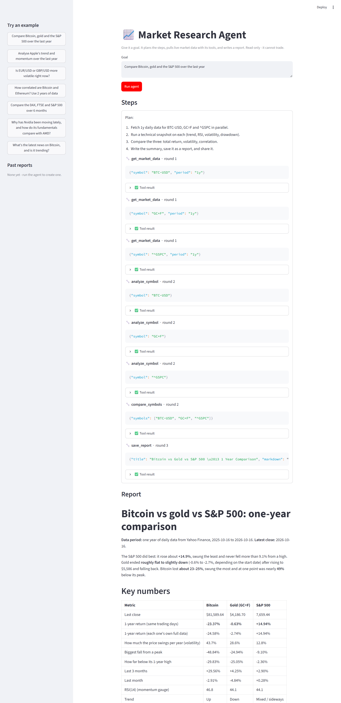

# Market Research Agent — beginner guide

Give it a goal in plain English, like *"Compare Bitcoin, gold and the S&P 500
over the last year"*. It plans the steps, pulls real market data, runs the
analysis, and writes and saves a summary report. You don't have to tell it
which steps to take.



This project shows the two core agent skills:
- **Tool calling.** The AI can't fetch data itself. It *asks* for a tool, our code runs it, and the result goes back to the AI.
- **Multi-step reasoning.** It plans, acts, looks at the results, and decides what to do next. That includes fixing its own mistakes, like a wrong ticker symbol.

## What this demonstrates

- **Tool calling:** six Python functions are described to Claude with JSON schemas; Claude decides when to call them and with what inputs.
- **A manual agent loop:** `agent.py` runs the loop itself (send → run requested tools → return results → repeat) instead of hiding it inside a framework, so every step is visible.
- **Multi-step planning:** from one plain-English goal, the agent plans which data to fetch, which analyses to run and in what order, running independent tools in parallel.
- **Error recovery:** tool failures (e.g. a wrong ticker) come back to Claude as error results, and it corrects itself and retries.
- **Safety limits:** read-only tools only (no trading), no buy/sell advice, and a hard step limit so it can't loop forever.

See [`examples/`](examples/) for two real reports it produced.

## How it works

```
 your goal
    │
    ▼
 ┌─────────── the agent loop (agent.py) ───────────┐
 │  Claude: "here's my plan… call get_market_data"  │
 │        │                                         │
 │        ▼                                         │
 │  our code runs the tool (tools.py) ──► result ───┤
 │        ▲                                   │     │
 │        └──── Claude reads it, picks next step ◄──┘
 │  …repeats until Claude says it's done            │
 └──────────────────────────────────────────────────┘
    │
    ▼
 summary on screen + saved in reports/
```

## Files

| File | What it does |
|---|---|
| `agent.py` | The agent loop: sends the goal and tools to Claude, runs the tools it asks for, feeds results back, and repeats. Read this to understand agents. |
| `app_streamlit.py` | The web version: the same agent, with each step drawn live on a page. |
| `tools.py` | The 6 tools: `get_market_data`, `analyze_symbol`, `compare_symbols`, `get_news`, `get_fundamentals`, `save_report`, plus the descriptions Claude reads to decide which one to use. |
| `reports/` | Saved summaries (created automatically). |
| `examples/` | Two sample reports from real runs. |
| `requirements.txt`, `.env.example` | Packages to install, and the template for your API key. |

## The tools

| Tool | What it does |
|---|---|
| `get_market_data` | Downloads daily prices from Yahoo Finance (free, no key). Works for stocks, crypto, forex, commodities and indices. |
| `analyze_symbol` | Calculates the trend (20/50/200-day averages), RSI, ATR, volatility, returns over 1 week / 1 month / 3 months, and the biggest drop from a peak. |
| `compare_symbols` | Compares several symbols side by side: return, volatility, and correlation (how closely they move together). |
| `get_news` | Latest headlines with short summaries and dates, for a ticker, company or topic (Yahoo Finance news feed / search). Used to explain *why* something moved. |
| `get_fundamentals` | Company fundamentals: market cap, P/E, PEG, EPS, margins, revenue and earnings growth, cash, debt, dividend, beta, analyst rating and targets, next earnings date. |
| `save_report` | Saves the finished summary as a Markdown file. |

**Safety:** the agent can only read data and save reports. There's deliberately
no trading tool, and it's told not to give buy/sell advice. There's also a step
limit (`MAX_STEPS = 15`) so it can never loop forever and run up your bill.

## Setup (one time)

You need Python 3.10 or newer.

```bash
git clone https://github.com/Dcryptoman/market-research-agent.git
cd market-research-agent
```

```bash
python -m venv .venv
```

Activate it. On Windows (PowerShell):

```bash
.\.venv\Scripts\Activate.ps1
```

On Mac/Linux it's `source .venv/bin/activate`. Then install the packages:

```bash
pip install -r requirements.txt
```

Then copy `.env.example` to `.env` and put your Anthropic API key in it
(get one at https://console.anthropic.com/ → API Keys). Keep `.env` private.

## Run it

Pass the goal straight in:

```bash
python agent.py "Compare Bitcoin, gold and the S&P 500 over the last year"
```

Or leave the goal off and it will ask you for one.

What you'll see while it works:
- `[agent]` is its plan.
- `[note]` is its short progress notes.
- `[tool 2]` is a tool it called. The number is the round, and tools called in the same round ran together.
- `[ok]` or `[error]` is what the tool returned.

The final summary prints at the end and is also saved in `reports/`.

### Web version

```bash
streamlit run app_streamlit.py --server.port 8502
```

Then open http://localhost:8502. Type a goal (or click an example in the
sidebar) and press **Run agent**. Every step appears as it happens:
- 💭 progress notes
- 🔧 each tool call and the inputs it was given
- ✅ each tool's result (click to expand)

The report appears at the end, with a download button. The sidebar also lets
you reopen past reports. It uses the exact same agent loop as the terminal
version; only the display is different.

### Goals to try
- `Analyse Apple's trend and momentum over the last year`
- `Is EUR/USD or GBP/USD more volatile right now?`
- `How correlated are Bitcoin and Ethereum? Use 2 years of data`
- `Compare the DAX, FTSE and S&P 500 over 6 months`
- `Why has Nvidia been moving lately, and how do its fundamentals compare with AMD?`
- `What's the latest news on Bitcoin, and is it trending?`

Symbols use Yahoo Finance format, but you can just name the market and the
agent picks the symbol. Common ones: `AAPL`, `BTC-USD`, `EURUSD=X`, `GC=F`
(gold), `CL=F` (oil), `^GSPC` (S&P 500), `^GDAXI` (DAX), `^FTSE`.

## Cost

Each goal is usually 3–6 rounds with Claude, so roughly 5–15 cents per report
on Claude Opus 5.5. Change `MODEL` in `agent.py` to `claude-sonnet-5-5` to make
it about half the price.

## Ideas to extend it (good portfolio upgrades)

- Add a tool, such as `get_insider_trades(symbol)` or `get_options_summary(symbol)`. You add a function and a description in `tools.py`, and the agent starts using it with no other changes.
- Add a chart tool that saves a PNG price chart into the report.
